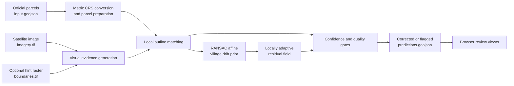

# Technical Report — GeoAlign AI

## 1. Project overview

GeoAlign AI is an ML-assisted geospatial system for correcting the placement of cadastral parcel boundaries against satellite imagery. Historical parcel maps can retain approximately the correct shape while being displaced from visible field edges after scanning, digitisation, or georeferencing. The system estimates this placement error, corrects it only when the visual and spatial evidence is strong, and flags ambiguous parcels for review.

The project is an independent implementation. Public BhuMe repositories were studied during initial problem exploration, but no source code is vendored. The implementation, evaluation logic, viewer, and generated output in this repository are maintained independently.

### Goals

- Align official parcel polygons with observable boundaries in satellite imagery.
- Keep corrections conservative: uncertain cases are flagged rather than forcibly moved.
- Produce valid, reviewable GeoJSON for every input parcel.
- Make every decision inspectable through confidence values and method notes.
- Support a small-data setting without training a high-capacity deep-learning model on the six public truth examples.

## 2. Problem definition

For each official parcel polygon \(P_i\), the system estimates a displacement vector \(d_i=(\Delta x,\Delta y)\). It searches for the translation that places the parcel outline on nearby image evidence:

\[
P'_i = P_i + d_i
\]

The objective is not to change parcel ownership or redraw field shapes. It is to correct plausible **placement error** while preserving unreliable or non-translation cases for human review.

## 3. Inputs and outputs

| Asset | Required | Description |
|---|---:|---|
| `input.geojson` | Yes | Official parcel polygons, plot identifiers, and area metadata. |
| `imagery.tif` | Yes | Satellite raster used to derive field-edge evidence. |
| `boundaries.tif` | No | Supporting boundary-hint raster; it supplements, never replaces, imagery evidence. |
| `example_truths.geojson` | No | Public hand-aligned examples used only for post-prediction evaluation. |
| `predictions.geojson` | Produced | A parcel-level output with `corrected` or `flagged` status, confidence, method note, and valid geometry. |

All distance-sensitive processing is performed in a local UTM coordinate reference system. Input and output GeoJSON remain in WGS84 (EPSG:4326).

## 4. System architecture



The architecture separates image evidence, local geometry matching, village-scale regularisation, and decision logic. This makes the result easier to inspect than an opaque end-to-end model.

## 5. Data-processing pipeline

### 5.1 Parcel preparation

The program reads official GeoJSON polygons, preserves the original plot identifier, filters or normalises invalid geometries, and selects a local UTM CRS based on parcel location. Metric coordinates are required because translations, areas, and centroid error must be measured in metres rather than degrees.

### 5.2 Edge-affinity generation

The satellite RGB patch is transformed into an edge-affinity surface:

1. Convert the image patch to grayscale.
2. Apply a Scharr gradient to detect intensity transitions.
3. Apply Canny edge detection to emphasise sharp contours.
4. Smooth and normalise the combined signal.
5. Optionally fuse a lower-weight boundary-hint raster.

High affinity represents pixels that are plausible field boundaries. The system matches a parcel **outline**, not its filled interior, reducing sensitivity to crop colour and seasonal appearance.

### 5.3 Local parcel matching

Each official polygon boundary is rasterised as a thin buffered ring in a padded local image patch. FFT cross-correlation compares that ring with the edge-affinity surface across many candidate translations efficiently. The best peak yields:

- east/north displacement;
- local edge-support score;
- support improvement over the original position;
- peak-to-sidelobe ratio (PSR), indicating whether the match is unambiguous;
- usability flag.

The allowed search radius scales with the square root of parcel area and is capped. This prevents small plots from jumping to distant, unrelated edges.

### 5.4 Village-scale spatial regularisation

Individual image matches can fail due to roofs, roads, shadows, tracks, vegetation, or weak field boundaries. High-quality local matches are therefore treated as anchors for a RANSAC affine transformation. RANSAC repeatedly fits a village-scale drift model while rejecting outlier anchors.

The affine model provides stable global behaviour. A clipped inverse-distance-weighted residual field then adds limited local adaptation from nearby inlier residuals. The combination preserves coherent village drift without forcing every parcel to use the same translation.

### 5.5 Correct-or-flag decision

A parcel is corrected only if it passes the following gates:

- usable local visual evidence;
- acceptable area consistency;
- confidence at least 0.34;
- total displacement no greater than 35 m;
- no indication that the original parcel is already aligned.

Otherwise its official geometry is retained and its status is set to `flagged`. Rare invalid output geometries are normalised with `make_valid`; this does not convert a flagged plot into a confident correction.

## 6. AI, ML, and spatial techniques

| Technique | Category | Purpose |
|---|---|---|
| Scharr gradients and Canny edges | Computer vision | Extract likely visible field boundaries from imagery. |
| FFT cross-correlation | Signal processing | Find the translation where a parcel outline best matches local evidence. |
| RANSAC affine fitting | Robust machine learning / estimation | Fit village drift using reliable anchors while rejecting outliers. |
| Inverse-distance residual interpolation | Spatial learning | Adapt global drift locally using nearby inlier residuals. |
| Random Forest regression | Supervised machine learning | Predict expected recovery IoU for standard confidence scoring. |

### Trained ML confidence model

The repository includes `fieldalign/ml_confidence.py`, a genuine supervised machine-learning component. It trains a `RandomForestRegressor` using synthetic recovery tasks:

1. Select valid official parcels as pseudo-references.
2. Apply a known random metric translation.
3. Run the same image-based matcher used during inference.
4. Measure recovery IoU between the matched polygon and the pseudo-reference.
5. Train the model to predict recovery IoU from evidence features.

Features include PSR, edge score, improvement over original alignment, predicted shift length, log area, area ratio, and local-match usability. This self-supervised design avoids consuming the small public hand-aligned truth set for training.

At inference time, ML confidence and heuristic confidence are blended equally in every standard run. The number of parcels used to generate synthetic training examples can be adjusted with `--ml-samples` (default: 80). The full village has been run with this mandatory ML configuration: the model trained on 320 synthetic recovery examples and produced valid output for all 2,457 parcels.

Train and save a reusable model artifact without creating predictions:

```powershell
& ".\.venv\Scripts\python.exe" .\train_ml_model.py "C:\path\to\village" --samples 80
```

## 7. Validation and results

The completed ML-enabled independent run processed the full village:

| Metric | Result |
|---|---:|
| Parcels processed | 2,457 |
| Corrected parcels | 1,892 |
| Flagged parcels | 565 |
| Invalid geometries in final output | 0 |
| Public reference plots scored | 6 |
| Median official-input IoU | 0.584 |
| Median prediction IoU | 0.884 |
| Median IoU improvement | +0.300 |
| Median centroid error | 2.739 m |
| Public plots improved | 6 / 6 |

The six public truths are a small directional evaluation set, not a complete measure of generalisation. They are deliberately excluded from fitting the alignment model and the synthetic-ML training procedure. All 1,892 corrected output records include a per-parcel `ml_iou` estimate in their method note.

### Evaluation checks

`evaluate.py` verifies:

- required fields: `plot_number`, `status`, and `geometry`;
- corrected and flagged output counts;
- invalid geometry count;
- missing confidence values for corrected parcels;
- median IoU and centroid error against available public truths.

Run the complete pipeline and evaluation:

```powershell
.\run_full.ps1
```

## 8. Interactive review viewer

The static viewer at `viewer/index.html` supports manual quality assurance without a backend:

1. Create a PNG/JPG preview from the GeoTIFF:

   ```powershell
   & "..\.venv-validate\Scripts\python.exe" .\make_preview.py "C:\path\to\village"
   ```

2. Open `viewer/index.html` in a browser.
3. Upload the satellite preview, generated predictions GeoJSON, and optionally official input GeoJSON.
4. Enter the preview bounds in EPSG:4326.
5. Render the overlay and click a parcel to inspect its status, confidence, and method note.

Corrected parcels are green, flagged parcels are orange, and the optional official input overlay is navy blue.

## 9. Reproducibility

### Environment

- Python 3.12+
- GeoPandas, Rasterio, Shapely, PyProj
- NumPy, SciPy, scikit-image
- scikit-learn (optional ML confidence estimator)

Install project dependencies from `pyproject.toml` in a clean Python environment, then run:

```powershell
& ".\.venv\Scripts\python.exe" .\main.py "C:\path\to\village"
```

For a short development run:

```powershell
& ".\.venv\Scripts\python.exe" .\main.py "C:\path\to\village" --limit 10
```

Large imagery files are intentionally excluded from Git. Retain the project raster inputs locally or distribute them through an appropriate data channel.

## 10. Design trade-offs

| Decision | Benefit | Trade-off |
|---|---|---|
| Classical computer vision before deep learning | Works with limited labelled data and remains interpretable. | Cannot learn rich semantic distinctions such as crop versus road. |
| Outline matching | Focuses directly on visible boundaries. | Weak if boundaries are visually absent. |
| Per-plot image patches | Limits memory use and keeps decisions local. | Repeated patch extraction costs processing time. |
| RANSAC + local residuals | Balances stable global drift and local adaptation. | Residual interpolation can spread local error if anchors are poor. |
| Conservative flagging | Reduces harmful over-correction. | Lowers automatic correction coverage. |
| Synthetic ML labels | Avoids leakage from public truth examples. | Calibration must be confirmed using more real held-out labels. |

## 11. Limitations and future work

- Expand the held-out hand-aligned reference set across villages.
- Evaluate the mandatory ML-confidence pipeline on a larger held-out truth set before making claims about generalisation.
- Add topology-aware joint optimisation so neighbouring parcels preserve shared boundaries.
- Add constrained rotation and scale refinement for distortions that are not pure translations.
- Explore semantic segmentation or foundation-model features when sufficient labelled imagery is available.
- Prioritise manual review using uncertainty, parcel area, and expected impact.
- Parallelise patch processing and cache raster transforms to reduce runtime.

## 12. Repository map

```text
fieldalign/pipeline.py       Core alignment, quality gates, and GeoJSON export
fieldalign/ml_confidence.py  Mandatory synthetic-label Random Forest confidence model
train_ml_model.py            Standalone model-training and artifact-export command
main.py                      Command-line entry point
evaluate.py                  Contract checks and public-truth evaluation
run_full.ps1                 Full-village run and evaluation helper
make_preview.py              GeoTIFF to browser-preview utility
viewer/index.html            Static interactive QA viewer
data/                        Local data and generated output guidance
```

## 13. Responsible use

This system is a decision-support and quality-assurance tool. A `corrected` output reflects image and spatial evidence, not a legal determination of ownership or cadastral authority. Flagged parcels should be reviewed by qualified personnel before any administrative or legal action.
